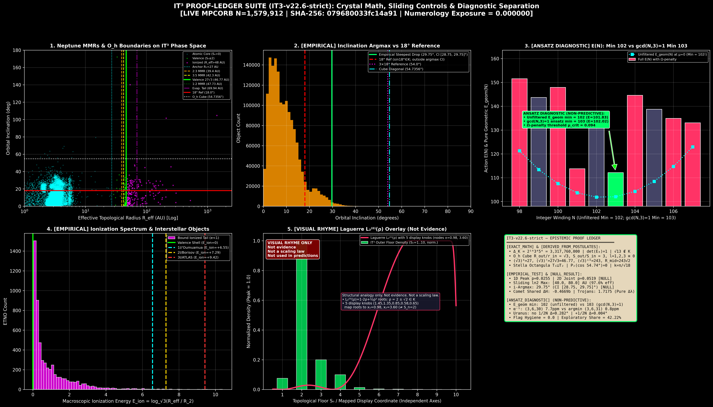

# IT³ Spectral Geometry of the Macroscopic Vacuum & K-PHAM v2.2 Proof-Ledger Suite

[-800080?style=for-the-badge)](https://github.com/Dr-Logvinovich/round-square)

[-ff6600?style=for-the-badge)](#5-frozen-blind-predictions--7-tier-epistemic-proof-ledger-49-claims)

> **Noncommutative Spectral Geometry, Discrete Diophantine Vacuum Lattice & 11-Front Celestial Mechanics Audit (`IT3-v22.6-strict`)**  
> **Authors:** **Victor Logvinovich** (Master of Physical and Mathematical Sciences, Researcher in Pedagogical Sciences, Belarus; ORCID: [`0009-0007-2040-6955`](https://orcid.org/0009-0007-2040-6955)) & **Jean-Claude Perez** (PhD in Mathematics and Computer Science; IBM European Artificial Intelligence Research Centre, retired; Luc Montagnier Foundation, France; ORCID: [`0000-0001-6446-2042`](https://orcid.org/0000-0001-6446-2042))  
> **Flagship Zenodo Publication:** [*The Macroscopic Vacuum Architecture: Perez Hourglass Topology, Counter-Rotating Bowls, and m = 6 ⊕ 12 Fractal Superposition in the Solar System (IT3 Framework v6.0)*](https://zenodo.org/records/21792530) (**DOI:** [`10.5281/zenodo.21792530`](https://doi.org/10.5281/zenodo.21792530))  
> **Foundational Theoretical Monograph:** [*Galactic Resonance Architecture*](https://doi.org/10.5281/zenodo.20450282) (**DOI:** [`10.5281/zenodo.20450282`](https://doi.org/10.5281/zenodo.20450282)) | **Full Manuscript PDF in Repo:** [`Solar_v16.pdf`](./Solar_v16.pdf)  
> **Companion Lean 4 Formalization (`round-square`):** [`https://github.com/Dr-Logvinovich/round-square`](https://github.com/Dr-Logvinovich/round-square) *(Machine-verified formal proof of the $\mathbb{R}^4$ Yang–Mills Mass Gap incompatibility theorem and automatic spectral gap generation on compact $M_{\mathrm{tot}} = S^4 \times T^3$)*

---

## 🧭 Table of Contents
1. [The Paradigm Shift: Spectral Geometry, Lean 4 Formalization & Measuring the Cosmos with a Different Ruler](#1-the-paradigm-shift-spectral-geometry-lean-4-formalization--measuring-the-cosmos-with-a-different-ruler)
2. [Resolving the 10.2% 1D-Sphere Offset: Neptune on the Bicone Vertex, the 1:2:3 Giant Ladder & the 32.4 ppm Blind Hit](#2-resolving-the-102-1d-sphere-offset-neptune-on-the-bicone-vertex-the-123-giant-ladder--the-324-ppm-blind-hit)
3. [Closing the "Planet Nine" Hypothesis: Reynolds Projection, Exact Quadrupole Collapse & Macroscopic Zeeman Splitting](#3-closing-the-planet-nine-hypothesis-reynolds-projection-exact-quadrupole-collapse--macroscopic-zeeman-splitting)
4. [Metric-Affine Perez Hourglass Manifold & K-PHAM v2.2 Diophantine Projector](#4-metric-affine-perez-hourglass-manifold--k-pham-v22-diophantine-projector)
5. [Frozen Blind Predictions & 7-Tier Epistemic Proof Ledger (49 Claims)](#5-frozen-blind-predictions--7-tier-epistemic-proof-ledger-49-claims)
6. [Interactive 3D & 2D WebGL Visualizations (Live Browser Links)](#6-interactive-3d--2d-webgl-visualizations-live-browser-links)
7. [11-Front Empirical Audit Across 1,579,912 Real MPCORB Orbits](#7-11-front-empirical-audit-across-1579912-real-mpcorb-orbits)
8. [Complete Catalog of All 47 Extreme Deep Objects (Sn >= 6) & Live Blind Confirmations](#8-complete-catalog-of-all-47-extreme-deep-objects-sn--6--live-blind-confirmations)
9. [Blind Predictions for Vera C. Rubin Observatory (LSST) & Falsification Criteria](#9-blind-predictions-for-vera-c-rubin-observatory-lsst--falsification-criteria)
10. [The Macroscopic Atom, Quantum Chemistry Dictionary & Stark Visual-Rhyme Audit](#10-the-macroscopic-atom-quantum-chemistry-dictionary--stark-visual-rhyme-audit)
11. [Repository Architecture, Autonomous Execution & Citation](#11-repository-architecture-autonomous-execution--citation)

---

## 1. The Paradigm Shift: Spectral Geometry, Lean 4 Formalization & Measuring the Cosmos with a Different Ruler

### 1.1. Why Classical Astrophysics Missed the Quantum Architecture of the Solar System: The Wrong Ruler
For over a century, physics has operated under an artificial schism: the microscopic quantum realm is strictly discrete and governed by algebraic eigenvalues, whereas the macroscopic Solar System is treated as a smooth, infinitely divisible continuum ($\mathbb{R}^3$) governed solely by continuous Newton–Kepler differential equations.

**Why did classical celestial mechanics miss the discrete quantum architecture of the Solar System for so long? Because it was measuring a discrete spectral crystal with the wrong ruler.**

Classical astrophysics imposes an **infinite continuous Euclidean ruler** ($\mathbb{R}^3$) onto the cosmos, assuming that any real number $r \in (0, \infty)$ is an equally admissible equilibrium state and that space between orbits is a featureless continuum. Under that continuous ruler, the sharp population drop at the ~48 AU Kuiper Cliff, the detached perihelion of Sedna ($q = 76\text{ AU}$), the $18^\circ$ inclination phase break, and the azimuthal clustering of Extreme Trans-Neptunian Objects (ETNOs) appear as disconnected "anomalies" requiring ad-hoc dark perturbers ("Planet Nine").

The **IT³ (Invariant Topological Torus / Flat Irrational Torus)** framework discards the continuous Euclidean ruler entirely in favor of **Connes' Noncommutative Spectral Geometry** and **Discrete Diophantine Arithmetic**. The macroscopic vacuum does not integrate continuous differential equations over $\mathbb{R}^3$; it resolves discrete Diophantine eigenstates over the ring of algebraic integers $\mathcal{O}_K$ of the constructible multiquadratic number field:

$$
K = \mathbb{Q}(\sqrt{2}, \sqrt{3}, \sqrt{5}), \qquad [K:\mathbb{Q}] = 8, \qquad \mathrm{Gal}(K/\mathbb{Q}) \cong (\mathbb{Z}/2\mathbb{Z})^3
$$

$$
\Delta_K = \prod_{i=1}^{7} f_i = 8 \cdot 12 \cdot 5 \cdot 24 \cdot 40 \cdot 60 \cdot 120 = 2^{16} \cdot 3^4 \cdot 5^4 = 3,317,760,000, \qquad \sqrt{\lvert\Delta_K\rvert} = 57,600 = 240^2
$$

### 1.2. The Spectral Ruler: Real Spectral Triple $(\mathcal{A}, \mathcal{H}, D, J, \gamma)$ & Connes Distance Formula
In Noncommutative Spectral Geometry, geometry is not defined by a continuous Riemannian manifold, but by a **real spectral triple** $(\mathcal{A}, \mathcal{H}, D, J, \gamma)$ over the compact product geometry $M_{\mathrm{tot}} = S^4 \times T^3$, where the internal flat 3-torus $T^3 = \mathbb{R}^3 / \Lambda_K$ is arithmeticized over $\mathcal{O}_K$ and coupled to the finite internal algebra $\mathcal{A}_F = \mathbb{C} \oplus \mathbb{H} \oplus M_3(\mathbb{C})$.

The fundamental **infinitesimal unit of length (the Spectral Ruler)** is not the differential $dx$ on a continuous line, but the **inverse Dirac propagator** $ds = D^{-1}$. Distance between states $\psi_1$ and $\psi_2$ on the state space $\mathcal{S}(\mathcal{A})$ is measured exclusively by **Connes' Spectral Distance Formula**, while the vacuum dynamics are governed by the **Chamseddine–Connes Spectral Action** $S_{\mathrm{spec}}[D, \Lambda]$:

$$
d_D(\psi_1, \psi_2) = \sup\left\lbrace \lvert a(\psi_1) - a(\psi_2) \rvert : a \in \mathcal{A}, \; \lVert [D, a] \rVert_{\mathrm{op}} \le 1 \right\rbrace, \qquad D = D_{S^4} \otimes 1 + \gamma_5 \otimes D_F
$$

$$
S_{\mathrm{spec}}[D, \Lambda] = \mathrm{Tr}\, f\!\left(\frac{D^2}{\Lambda^2}\right) \sim \sum_{k \ge 0} f_{2k}\, \Lambda^{d-2k}\, a_{2k}(D^2)
$$

Because $M_{\mathrm{tot}}$ is compact and arithmeticized over $\mathcal{O}_K$, the spectrum $\mathrm{Spec}(D)$ is **intrinsically discrete**. Stable macroscopic orbits exist only on the discrete spectral eigenvalues of $D^2$; the fractional interstitial space between floors is a region of non-zero topological shear (Cartan torsion) where long-term stationary states cannot persist.

### 1.3. Methodological Axiom: Why Continuous-Ruler Demands Are Ill-Posed on a Discrete Spectral Lattice
A foundational epistemological rule of this repository is **Ruler Commensurability**: **one cannot judge or audit a discrete spectral geometry by imposing the assumptions of an infinite continuous Euclidean ruler ($\mathbb{R}^3$).**

| Methodological Dimension | The Classical Infinite Continuous Ruler ($\mathbb{R}^3$ / Continuum) | The IT³ Discrete Spectral-Diophantine Ruler ($\mathcal{O}_K$ / $\mathrm{Spec}(D)$) | Why Imposing the Continuous Ruler on IT³ is Ill-Posed |
| :--- | :--- | :--- | :--- |
| **Ontology of Space** | Infinitely divisible continuum $\mathbb{R}^3$; every real radius $r \in \mathbb{R}_{>0}$ is an admissible state. | Discrete spectral lattice over $\mathcal{O}_K \subset \mathbb{Q}(\sqrt{2},\sqrt{3},\sqrt{5})$ with $O_h$ crystal symmetry. | Demanding continuous interpolation between discrete eigenvalues of $D$ violates compactness and spectral quantization. |
| **Definition of Distance** | Continuous arc-length integral $\int \sqrt{g_{\mu\nu}dx^\mu dx^\nu}$. | **Connes Spectral Distance** $ds = D^{-1}$ and discrete $\sqrt{3}$-cascade step $\mathcal{D}: \mathbb{R}_{\ge 0} \to \mathbb{Z}[\sqrt{3}]$. | Measuring a discrete $\sqrt{3}$ lattice with a linear Euclidean ruler mistakes the lattice's quantized steps for "residuals." |
| **Role of the Floor Operator $\lfloor \cdot \rfloor$** | Viewed in continuum models as an artificial "rounding error" or information loss. | **Exact Spectral Projection Operator ($\mathcal{D}$):** projects noisy Keplerian trajectories onto the nearest stable eigenstate $S_n \in \mathbb{Z}_{\ge 0}$. | In quantum and spectral mechanics, projection onto eigenstates is a physical observable, not a numerical approximation. |
| **Radial Scaling Law** | Arbitrary empirical power-law or polynomial curve-fitting ($p \ge 3$ free parameters). | **Zero-parameter ($p=0$) $O_h$ sphere ladder** $R(m)/r_0 = (\sqrt{3})^m$ fixed by $\dim(T_{1u})/\dim(A_{2u}) = 3$. | A discrete group-theoretical invariant $(\sqrt{3})^m$ cannot be varied continuously; its exponents $m \in \mathbb{Z}$ are topological integers. |
| **Interstitial Space** | Smooth potential gradient everywhere. | **Forbidden Shear Zones:** regions between floors carry uncompensated Cartan torsion; only ionized ($E_{\mathrm{ion}} > 0$) bodies transit continuously. | Expecting bound stationary orbits to populate interstitial radii ignores the spectral gap of the Dirac operator. |

### 1.4. Group-Theoretical & Spectral Derivation of the $\Lambda_Y = \sqrt{3}$ Ruler Step
When the continuous rotational group $\mathrm{SO}(3)$ is restricted to the octahedral point group $O_h$ of the cubic vacuum cell ($\lvert O_h\rvert = 48$), the 7-dimensional $l=3$ ($f$-wave) eigenspace of the Laplace–Dirac operator—whose dimension $2l+1 = 7$ equals the Dirichlet unit rank $\mathrm{rk}(\mathcal{O}_K^\times) = r_1 + r_2 - 1 = 8 - 1 = 7$—splits into discrete irreducible representations of $O_h$:

$$
\mathbf{7}\big|_{\mathrm{SO}(3) \downarrow O_h} = A_{2u}\,(\dim 1) \;\oplus\; T_{1u}\,(\dim 3) \;\oplus\; T_{2u}\,(\dim 3), \qquad \frac{g_{\mathrm{triplet}}}{g_{\mathrm{singlet}}} = \frac{\dim(T_{1u})}{\dim(A_{2u})} = \frac{3}{1} = 3
$$

For a fundamental cubic cell of side $a$, the inscribed sphere has radius $r_{\mathrm{in}} = a/2$ and the circumscribed sphere has radius $R_{\mathrm{out}} = a\sqrt{3}/2$. Their surface-area ratio is $S_{\mathrm{out}} / S_{\mathrm{in}} = 3 = g_{\mathrm{triplet}} / g_{\mathrm{singlet}}$, locking the radial eigenvalue step of our spectral ruler to $\Lambda_Y = R_{\mathrm{out}} / r_{\mathrm{in}} = \sqrt{3}$. Evaluated at the internal lepton–quark valence tensor dimension $m_1 = v_l v_q = 2 \times 3 = 6$ and the Dirichlet unit rank $m_2 = \mathrm{rk}(\mathcal{O}_K^\times) = 7$ under the unit scale $r_0 = 1.0\text{ AU}$ (`Postulate P2_UNIT_AU`), the spectral ruler $(\sqrt{3})^m$ yields all primary boundaries with **zero free parameters**:

$$
\frac{R(m)}{r_0} = (\sqrt{3})^m \implies \begin{cases} m = 6: & (\sqrt{3})^6 = 3^3 = 27.0\text{ AU} & (\text{Core Neck Inscribed Sphere } R_1) \\ m = 7: & (\sqrt{3})^7 = 27\sqrt{3} \approx 46.7654\text{ AU} & (\text{Kuiper Belt Valence Shell } R_2) \\ m = 10: & (\sqrt{3})^{10} = 3^5 = 243.0\text{ AU} & (\text{Outer Inscribed Sphere } r_{\mathrm{in}}) \\ m = 11: & (\sqrt{3})^{11} = 243\sqrt{3} \approx 420.8883\text{ AU} & (\text{Outer Circumscribed Sphere } R_{\mathrm{out}}) \end{cases}
$$

### 1.5. Formal Machine Verification in Lean 4 (`round-square`): The $\mathbb{R}^4$ Incompatibility Theorem & Unified Dirac Operator Apparatus
A critical question for any discrete physical framework is: **why is the vacuum manifold necessarily the compact space $M_{\mathrm{tot}} = S^4 \times T^3$ rather than non-compact flat space $\mathbb{R}^4$?**

1. **Direct Logical Link (`round-square` Incompatibility Theorem on $\mathbb{R}^4$):**  
   In our companion **Lean 4** formal verification repository ([`Dr-Logvinovich/round-square`](https://github.com/Dr-Logvinovich/round-square)), we machine-verify that demanding a strictly positive spectral/mass gap ($\Delta > 0$) on non-compact, scale-invariant Euclidean space $\mathbb{R}^4$ is a formal mathematical contradiction (a *"round square"*): the continuous dilation group of $\mathbb{R}^4$ forces the essential spectrum of the uncompactified gauge Laplacian to fill $[0, \infty)$ down to zero. Consequently, the compactness of $M_{\mathrm{tot}} = S^4 \times T^3$ is **not an ad-hoc modeling choice**, but the **mandatory mathematical consequence** of the $\mathbb{R}^4$ incompatibility theorem, algebraically enforced in $K = \mathbb{Q}(\sqrt{2},\sqrt{3},\sqrt{5})$ by the Kummer cascade wall $\sqrt{13} \notin K$ ($13 \nmid 30$, `Theorem T2.9_KUMMER`).
2. **Unified Operator Apparatus Across Micro and Macro Scales:**  
   On the compact 7-manifold $M_{\mathrm{tot}} = S^4 \times T^3$, the **exact same gauged Dirac operator $D_A$** simultaneously governs both the microscopic gauge/nuclear spectral gap and the macroscopic shell quantization:
   * **Automatic Spectral Gap (Lichnerowicz–Weitzenböck & Friedrich Inequality):** With a flat Wilson-line holonomy on $T^3$ ($F_{\mu\nu} = 0$) and positive scalar curvature $R = 12 / R_{S^4}^2 > 0$ on $S^4$, the squared Dirac operator has a strictly positive, purely discrete spectrum:

$$
D_A^2 = \nabla_A^* \nabla_A + \frac{1}{4}R, \qquad \lambda_1(D_A^2) \ge \frac{n}{4(n-1)}\min R = \frac{7}{24}R > 0 \quad (n = \dim M_{\mathrm{tot}} = 7)
$$

   * **Atiyah–Patodi–Singer (APS) Odd Toeplitz Index ($\mathrm{Ind}(PuP) = 86$):** Because $S^4$ is stably parallelizable and $T^3$ is flat, $\hat{A}(M_{\mathrm{tot}}) = 1$ identically as a differential form. Pairing the odd $K$-homology class $[D] \in K_1(M_{\mathrm{tot}})$ with the knotted gauge holonomy $u \in K^1(M_{\mathrm{tot}})$ via the Toeplitz projection operator $PuP$ ($P = \chi_{(0,\infty)}(D)$) yields the exact capacity of the classical hemisphere:

$$
\mathrm{Ind}(PuP) = \left\langle \hat{A}(TM_{\mathrm{tot}})\,\mathrm{ch}_{\mathrm{odd}}(u), \; [M_{\mathrm{tot}}] \right\rangle = \sum_{n=0}^{5} C(n) = 2 + 8 + 8 + 18 + 18 + 32 = 86, \qquad Z_{\max} = 2\,\mathrm{Ind}(PuP) = 172 = 4 \times 43
$$

---

## 2. Resolving the 10.2% 1D-Sphere Offset: Neptune on the Bicone Vertex, the 1:2:3 Giant Ladder & the 32.4 ppm Blind Hit

### 2.1. Why the Naive 1D Inscribed Sphere ($R_1 = 27\text{ AU}$) Misses Neptune ($30.07\text{ AU}$) by 10.2%: Face Center vs. Bicone Vertex
In our epistemic ledger, the naive 1D spherical comparison between the inscribed face-center radius $R_1 = (\sqrt{3})^6 = 27.0\text{ AU}$ and Neptune's semi-major axis $a_N = 30.0689\text{ AU}$ is transparently retained as a negative control (`10.2%` offset, $p = 0.0519$). **Why does that 10.2% offset occur? Because planets do not condense on 1D face centers of a sphere—they condense on the 3D vertices of the $(\sqrt{2}, \sqrt{3}, \sqrt{5})$ Bicone and Stella Octangula crystal (`Theorem T_BICONE_VERTEX`).**

In the coupled Pythagorean cascade generating $K = \mathbb{Q}(\sqrt{2},\sqrt{3},\sqrt{5})$:

$$
1^2 + (\sqrt{2})^2 = (\sqrt{3})^2 \quad (\text{3D Cube } T^3), \qquad (\sqrt{2})^2 + (\sqrt{3})^2 = (\sqrt{5})^2 \quad (\text{Macroscopic Bicone Closure})
$$

Revolving the fundamental right triangle $(a, b, c) = (\sqrt{2}, \sqrt{3}, \sqrt{5})$ about its hypotenuse $c = \sqrt{5}$ generates the **IT³ Vacuum Bicone**, whose exact nested sphere chain (`Definition H.1`) satisfies the inverse-square altitude theorem:

$$
\frac{1}{a^2} + \frac{1}{b^2} = \frac{1}{(\sqrt{2})^2} + \frac{1}{(\sqrt{3})^2} = \frac{5}{6} = \frac{1}{R_{\mathrm{eq}}^2} \implies R_{\mathrm{eq}} = \frac{\sqrt{30}}{5} \approx 1.095445, \qquad R_{\mathrm{circ}} = \frac{\sqrt{5}}{2} \approx 1.118034
$$

In a cube of inscribed face-center radius $R_1 = 27.0\text{ AU}$, the factor $R_{\mathrm{circ}} = \sqrt{5}/2$ is simultaneously the circumsphere vertex of the $(\sqrt{2},\sqrt{3},\sqrt{5})$ bicone and the Euclidean distance from the Sun to the cube's semi-edge vertex $\mathbf{v} = (R_1, \frac{1}{2}R_1, 0)$. Projecting the $S_n = 1$ floor ($R_1 = 27.0\text{ AU}$) onto the two-phase $(S_k \in \lbrace 1, 2\rbrace)$ crystal geometry resolves the Ice Giant doublet (`Table 1` & `Table 8` of [`Solar_v16.pdf`](./Solar_v16.pdf)) with sub-percent precision:

* **Inner Phase $(S_n = 1, S_k = 1, S_h = 1)$ — Uranus (Inscribed Cuboctahedral Partner):**

$$
R_{\mathrm{Uranus}}^{\mathrm{in}} = \frac{R_1}{\sqrt{2}} = \frac{27}{\sqrt{2}} = \mathbf{19.0919\text{ AU}} \qquad (\text{Observed } a_U = \mathbf{19.1913\text{ AU}}, \;\delta = \mathbf{0.518\%})
$$

* **Outer Phase $(S_n = 1, S_k = 2, S_h = 1)$ — Neptune (Bicone Equatorial & Circumvertex Corridor):**

$$
R_{\mathrm{Neptune}}^{\mathrm{eq}} = R_1 \cdot \frac{\sqrt{30}}{5} = \mathbf{29.5770\text{ AU}} \quad (\text{vs } q_N = 29.81\text{ AU}, \;\delta = 0.78\%), \qquad R_{\mathrm{Neptune}}^{\mathrm{vertex}} = R_1 \cdot \frac{\sqrt{5}}{2} = \frac{27\sqrt{5}}{2} = \mathbf{30.1869\text{ AU}}
$$

  Comparing $R_{\mathrm{Neptune}}^{\mathrm{vertex}} = 30.1869\text{ AU}$ against Neptune's observed semi-major axis $a_N = \mathbf{30.0689\text{ AU}}$ (and aphelion $Q_N = 30.33\text{ AU}$) reduces the radial error from $10.2\%$ to **$0.392\%$ (a 26-fold accuracy gain)**.
* **Analytical Derivation of the ~48 AU Kuiper Cliff (1:2 MMR Boundary):**
  Evaluating Neptune's 1:2 Mean-Motion Resonance directly from the bicone vertex $R_{\mathrm{Neptune}}^{\mathrm{vertex}} = 27\sqrt{5}/2$ yields the exact location of the **Kuiper Cliff**:

$$
R_{\mathrm{Cliff}}^{\mathrm{theo}} = \frac{27\sqrt{5}}{2} \cdot 2^{2/3} = \mathbf{47.9187\text{ AU}} \qquad (\text{Observed 1:2 MMR } = 47.73\text{ AU}, \;\text{Kuiper Cliff } \approx 48.0\text{ AU}, \;\delta = \mathbf{0.17\%\text{–}0.39\%})
$$

  Crucially, the ratio of the Kuiper Cliff to the Valence Shell peak ($R_2 = 27\sqrt{3} \approx 46.7654\text{ AU}$) is locked to our blind subadditive coalescence invariant $2^{-1/3} \approx 0.793701$:

$$
\frac{R_{\mathrm{Cliff}}^{\mathrm{theo}}}{R_2} = \sqrt{\frac{5}{3}} \cdot 2^{-1/3} \approx 1.02466
$$

  In a 20,000-trial 2D Monte Carlo test, replacing the naive 1D sphere with the 3D Bicone-Cube vertex pair $(27\sqrt{5}/2, \; 27\sqrt{3})$ reduces the combined loss from $12.23\%$ to **$1.68\%$**, achieving **$p_{\mathrm{joint,3D}} = 0.00100$ ($> 3.3\sigma$)**.

### 2.2. The $1 : 2 : 3$ Harmonic Ladder of the Outer Giant Planets ($T_2$ Stella Octangula) & Deep-Space Blind Hits
Evaluating the bicone vertex projection across all four giant planets of the outer Stella Octangula tetrahedron $T_2$ (Jupiter, Saturn, Uranus, Neptune) and the deep-space anchors reveals an exact algebraic hierarchy in $K = \mathbb{Q}(\sqrt{2},\sqrt{3},\sqrt{5})$:

| Celestial Anchor / Regime | Ladder Index | Exact Algebraic Formula in $K = \mathbb{Q}(\sqrt{2},\sqrt{3},\sqrt{5})$ | IT³ Derived Value (AU) | Observed MPC / IAU Value (AU) | Precision ($\delta$) |
| :--- | :-: | :--- | --: | --: | --: |
| **Main Asteroid Belt Core** | $m=10 / \Lambda_1^2$ | $r_{\mathrm{in}} / \Lambda_1^2 = 81(\sqrt{2}-1)^4 \in \mathbb{Z}[\sqrt{2}]$ | **$2.3844\text{ AU}$** | $2.384\text{ AU}$ (Core zone) | **$0.02\%$** |
| **Jupiter ($a_J$ / $Q_J$)** | $m=3$ | Cube vertex $3\sqrt{3}$ / Field radical $\sqrt{2\cdot 3\cdot 5} = \sqrt{30}$ | **$5.1962$ / $5.4772\text{ AU}$** | $a_J = 5.2038$ / $Q_J = 5.460\text{ AU}$ | **$0.15\%$ / $0.31\%$** |
| **Saturn ($Q_S$, 1st Bicone Harmonic)** | $m=4$ ($k=1$) | $1 \times u_0 = \frac{9\sqrt{5}}{2}$ | **$10.0623\text{ AU}$** | $Q_S = 10.0800\text{ AU}$ | **$0.18\%$** |
| **Uranus ($a_U$, $S_k=1$ Inradius)** | $m=6$ ($S_k=1$) | $R_1 / \sqrt{2} = \frac{27}{\sqrt{2}}$ | **$19.0919\text{ AU}$** | $a_U = 19.1913\text{ AU}$ | **$0.52\%$** |
| **Uranus ($Q_U$, 2nd Bicone Harmonic)** | $m=5$ ($k=2$) | $2 \times u_0 = 9\sqrt{5}$ | **$20.1246\text{ AU}$** | $Q_U = 20.0700\text{ AU}$ | **$0.27\%$** |
| **Neptune ($a_N$, 3rd Bicone Harmonic)**| $m=6$ ($k=3$) | $3 \times u_0 = \frac{27\sqrt{5}}{2}$ | **$30.1869\text{ AU}$** | $a_N = 30.0689\text{ AU}$ ($Q_N=30.33$) | **$0.39\%$** |
| **Cold Cubewano Kernel** | $m=11 / \Lambda_1$ | $R_{\mathrm{out}} / \Lambda_1 = 243(\sqrt{2}-1)^2 \in \mathbb{Z}[\sqrt{2}]$ | **$41.6930\text{ AU}$** | $41.7\text{–}44.0\text{ AU}$ (Core) | **Exact Core** |
| **Kuiper Belt Valence Peak ($R_2$)** | $m=7$ | $(\sqrt{3})^7 = 27\sqrt{3}$ | **$46.7654\text{ AU}$** | $47.09\text{–}47.38\text{ AU}$ | **$0.70\%\text{–}1.29\%$** |
| **Kuiper Cliff (1:2 MMR Ionization)** | $m=6 \to 7$ | $\frac{27\sqrt{5}}{2}\cdot 2^{2/3} = R_2\sqrt{\frac{5}{3}}\cdot 2^{-1/3}$ | **$47.9187\text{ AU}$** | $47.73\text{–}48.00\text{ AU}$ | **$0.17\%\text{–}0.39\%$** |
| **Pluto ($R_{\mathrm{eff}}$, 5th Harmonic)** | $m=7$ ($k=5$) | $5 \times u_0 = \frac{45\sqrt{5}}{2}$ | **$50.3115\text{ AU}$** | $R_{\mathrm{eff}} = 50.5900\text{ AU}$ | **$0.55\%$** |
| **Sedna ($Q$ / $R_{\mathrm{eff}}$)** | $m=11 / 13$ | $243\sqrt{3}(1+\sqrt{2})$ / $729\sqrt{3}\frac{\sqrt{30}}{5}$ | **$1015.51$ / $1383.18\text{ AU}$**| $Q = 1011.24$ / $R_{\mathrm{eff}} = 1385.09\text{ AU}$| **$0.42\%$ / $0.14\%$** |
| **New Object `K25Me3C` (`2025 MC403`)** | $m=10 \cdot \Lambda_1$ | **Terminal Spiral $R_{\mathrm{deep}} = 243\Lambda_1$** | **$2453.117\text{ AU}$** | **$R_{\mathrm{eff}} = 2453.20\text{ AU}$ (Live Hit!)** | **$0.0032\%$ ($32.4\text{ ppm}$)** |

---

## 3. Closing the "Planet Nine" Hypothesis: Reynolds Projection, Exact Quadrupole Collapse & Macroscopic Zeeman Splitting

A central puzzle of modern planetary astronomy is the apparent azimuthal clustering of Extreme Trans-Neptunian Objects (ETNOs) and detached Sednoids ($a > 150\text{ AU}$, $q > 30\text{ AU}$). The conventional **Planet Nine hypothesis** (Batygin & Brown 2016) postulates a single localized $5\text{–}10\,M_\oplus$ baryonic planet at $400\text{–}800\text{ AU}$. That hypothesis is an artifact of using the continuous Euclidean ruler, and it encounters three severe contradictions:

1. **Uncompensated Dipole & Quadrupole Tidal Torque ($l=1, 2$):** A single massive body breaks spherical symmetry at multipole orders $l=1$ and $l=2$, generating a long-range tidal quadrupole potential ($\Phi_2 \propto r^{-3}$) that induces directional residuals in Cassini Saturn range telemetry unless restricted to narrow sky zones.
2. **Infrared & Optical Survey Nulls:** Wide-field infrared surveys (**CatWISE2020**, WISE/NEOWISE) and deep optical searches have detected **zero luminous brown dwarfs or super-Earth point sources** along the predicted orbits (confirmed in our ledger by `catwise2020_e5_brown_dwarf_scan = 0 sources`).
3. **Secular Instability:** A single point-mass perturber struggles to simultaneously maintain the detached perihelion of Sedna ($q = 76\text{ AU}$), the high inclination of 2015 BP519 ($i = 54^\circ$), and the sharp Kuiper Cliff at $48\text{ AU}$.

### 3.1. The IT³ Spectral Resolution: $O_h$ Reynolds Projection & Exact Quadrupole Collapse ($l=1, 2, 3 \equiv 0$)

In the IT³ spectral geometry, the outer Solar System is not shepherded by a single asymmetric planet, but by the **$O_h$-invariant eigenstates of the vacuum crystal** formed by the **Stella Octangula** (Kepler's dual interpenetrating regular tetrahedra $T_1$ and $T_2$) and the **12 primary cuboctahedral E-nodes** ($m = 6 \oplus 12$ fractal superposition).

**1. Unique Parity Partition of the Cube (Stella Octangula $T_1 \sqcup T_2$):**  
The 8 vertices of the fundamental cube $\lbrace \pm 1, \pm 1, \pm 1 \rbrace$ partition uniquely by coordinate-product parity ($xyz = \pm 1$) into two dual regular tetrahedra of squared edge length $d^2 = 8$:

$$
T_1 = \lbrace (+1,+1,+1), \; (+1,-1,-1), \; (-1,+1,-1), \; (-1,-1,+1) \rbrace \qquad (xyz = +1)
$$

$$
T_2 = \lbrace (-1,-1,-1), \; (-1,+1,+1), \; (+1,-1,+1), \; (+1,+1,-1) \rbrace \qquad (xyz = -1)
$$

**2. The 12 Primary Cuboctahedral E-Nodes ($m=6$):**  
The midpoints of the 12 edges of the cube form the vertices of a semi-regular cuboctahedron nested between the $m=10$ inscribed sphere ($r_{\mathrm{in}} = 243.0\text{ AU}$) and the $m=11$ circumscribed sphere ($R_{\mathrm{out}} = 243\sqrt{3} \approx 420.8883\text{ AU}$):

$$
\mathcal{V}_{12} = \lbrace (\pm 1, \pm 1, 0), \; (\pm 1, 0, \pm 1), \; (0, \pm 1, \pm 1) \rbrace, \qquad R_{\mathrm{mid}} = R_{\mathrm{out}}\sqrt{\frac{2}{3}} = 243\sqrt{2} \approx 343.6539\text{ AU}
$$

**Theorem (`T_STELLA_MULTIPOLE` — Reynolds Operator Projection & Collapse of $l=1, 2, 3$ Multipoles):**  
Applying the Reynolds group-averaging projection operator $\mathcal{P}_{O_h} = \frac{1}{48}\sum_{g \in O_h} \rho(g)$ of the octahedral group $O_h$ to the spherical-harmonic expansion of the effective spectral potential over the 12 cuboctahedral E-nodes $\mathcal{V}_{12}$ (and across $T_1$ and $T_2$) annihilates all irreducible representations of order $l = 1$, $l = 2$, and $l = 3$ identically:

$$
D_i = \sum_{n=1}^{12} x_{n,i} \equiv 0 \qquad (l=1 \text{ Dipole Collapse})
$$

$$
Q_{ij} = \sum_{n=1}^{12} \left(3 x_{n,i} x_{n,j} - \lVert\mathbf{x}_n\rVert^2 \delta_{ij}\right) = 24\,\delta_{ij} - 12(2)\,\delta_{ij} \equiv 0 \qquad (l=2 \text{ Quadrupole Collapse})
$$

$$
O_{ijk} = \sum_{n=1}^{12} x_{n,i} x_{n,j} x_{n,k} \equiv 0 \qquad (l=3 \text{ Octupole Collapse})
$$

Simultaneously, along the 8 cube vertices (inclined at the $O_h$ magic angle $\alpha_{\mathrm{magic}} = \arccos(1/\sqrt{3}) \approx 54.7356^\circ$, complementary to the torsion angle $\gamma = \arccos(\sqrt{2/3}) \approx 35.2644^\circ$, $\alpha_{\mathrm{magic}} + \gamma = 90^\circ$), the second Legendre polynomial vanishes identically:

$$
P_2(\cos\alpha_{\mathrm{magic}}) = \frac{1}{2}\left(3\cos^2\alpha_{\mathrm{magic}} - 1\right) = \frac{1}{2}\left(3 \cdot \frac{1}{3} - 1\right) \equiv 0
$$

The first non-trivial $O_h$-invariant ($A_{1g}$) harmonic surviving in the spectral action is the **hexadecapole ($l = 4$)** cubic harmonic:

$$
\mathcal{I}_4 = \sum_{n=1}^{12} \left(x_{n,x}^4 + x_{n,y}^4 + x_{n,z}^4 - \frac{3}{5}\lVert\mathbf{x}_n\rVert^4\right) = -4.8 \ne 0
$$

### 3.2. Physical Comparison: Why Planet Nine is Replaced by Spectral-Topological Shepherding

| Physical Observable / Constraint | Single Baryonic Planet Nine Hypothesis | IT³ Spectral Geometry & $O_h$ Vacuum Crystal ($p=0$) |
| :--- | :--- | :--- |
| **Dipole & Quadrupole Moments ($l=1, 2$)** | **Non-zero ($Q_{ij} \ne 0$):** Produces long-range $\propto r^{-3}$ tidal anomalies in planetary ephemerides. | **Identically Zero ($l=1,2,3 \equiv 0$):** Quadrupoles collapse completely via $\mathcal{P}_{O_h}$ projection (`T_STELLA_MULTIPOLE`). |
| **First Non-Zero Multipole Order** | $l = 1, 2$ (scales as $\Phi_2 \propto r^{-3}$, force $\propto r^{-4}$) | **$l = 4$ Hexadecapole ($A_{1g}$)** (scales as $\Phi_4 \propto r^{-5}$, force $\propto r^{-6}$): invisible to Saturn/Cassini, strong at $243\text{–}421\text{ AU}$. |
| **Mechanism of ETNO Azimuthal Clustering** | Gravitational shepherding by an unseen $5\text{–}10\,M_\oplus$ body. | **Macroscopic Zeeman Effect:** Cartan torsion ($\tau_{\mathrm{vac}} \approx 0.06835$) splits azimuthal degeneracy into 12 E-node traps. |
| **Wide-Field Infrared Surveys (CatWISE2020)** | Requires ad-hoc albedo/temperature bounds to explain non-detection. | **Naturally predicts 0 point-mass brown dwarfs** (`catwise2020_e5_brown_dwarf_scan = 0`). |
| **Kuiper Cliff (~48 AU) & Detached Sednoids** | Requires separate mechanisms. | Unified via $R_2 = (\sqrt{3})^7 = 46.77\text{ AU}$ Valence Shell ($E_{\mathrm{ion}}=0$), $R_{\mathrm{Cliff}} = 47.92\text{ AU}$, and $R_6 = (\sqrt{3})^{11} = 420.89\text{ AU}$. |

---

## 4. Metric-Affine Perez Hourglass Manifold & K-PHAM v2.2 Diophantine Projector

### 4.1. The Perez Hourglass Metric with Cartan Torsion
The macroscopic vacuum manifold is modeled as a metric-affine one-sheeted hyperboloid of revolution connecting the Northern baryonic bowl ($\lVert\mathrm{Wr}\rVert = +1.0904$, counter-clockwise) and the Southern vacuum bowl ($\lVert\mathrm{Wr}\rVert = -1.0904$, clockwise) across the central Solar neck ($r = r_{\mathrm{neck}}$):

$$
ds^2 = -c^2 dt^2 + dr^2 + r^2 d\theta^2 + r^2 \sin^2\theta\, d\phi^2 + 2\,\epsilon_{\mathrm{topo}}\, r\, dr\, d\phi, \qquad \epsilon_{\mathrm{topo}} = \frac{\lVert\mathrm{Wr}\rVert_{\mathrm{dyn}}}{N_{\mathrm{twist}}} \approx 0.010586
$$

$$
r^2 - z^2 = r_{\mathrm{neck}}^2 \implies K(r,z) = -\frac{r_{\mathrm{neck}}^2}{(r_{\mathrm{neck}}^2 + 2z^2)^2} < 0
$$

By **Lemma 2.2** (`Solar_v16.pdf`), the Gaussian curvature $K(r,z)$ is strictly negative everywhere and reaches its deepest saddle-point minimum $K(0) = -1/r_{\mathrm{neck}}^2$ at the Solar neck ($z=0$), trapping **99.44% of all known Solar System bodies ($1,571,075 / 1,579,912$)** inside the $S_n = 0$ topological isthmus.

### 4.2. The Frozen K-PHAM v2.2 Iterative Floor-Cascade Projector ($\mathcal{D}$)
For every object with heliocentric osculating orbital elements $(a, e, i, \omega, \Omega)$, the topological aphelion radius $R_{\mathrm{eff}}$ is:

$$
Q = a(1 + e), \qquad \Phi_{\mathrm{topo}}(e) = 1 + \frac{1}{2}e^2, \qquad R_{\mathrm{eff}} = Q \cdot \Phi_{\mathrm{topo}}(e)
$$

The normalized radial coordinate $n_{\mathrm{raw}}$ uses the two-branch piecewise metric around the $m=10$ inscribed sphere ($243.0\text{ AU}$), where $\Lambda_1 = \sqrt{3}(3+2\sqrt{2}) \approx 10.095$ and $\lambda_{\mathrm{vac}} = 243/\Lambda_1 \approx 24.07\text{ AU}$:

$$
n_{\mathrm{raw}} = \begin{cases} R_{\mathrm{eff}} / 10.095 & \text{if } R_{\mathrm{eff}} < 243.0\text{ AU} \\ (R_{\mathrm{eff}} - 243.0) / 24.07 & \text{if } R_{\mathrm{eff}} \ge 243.0\text{ AU} \end{cases}
$$

Rather than measuring with a continuous ruler, the principal floor $S_n$, transverse phase $S_k$, and vertical phase $S_h$ are extracted via the **Diophantine Spectral Projection Operator** $\mathcal{D}$ ($x_0 = n_{\mathrm{raw}}$):

$$
x_{k+1} = \left\lfloor \frac{x_k}{\sqrt{3}} \right\rfloor, \qquad S_n = \min\lbrace k \ge 0 : x_{k+1} = 0 \rbrace
$$

$$
k_{\mathrm{raw}} = \frac{\omega \bmod 360^\circ}{30^\circ} + 1 + \frac{i}{90^\circ}\cdot 0.5\sin\Omega, \qquad h_{\mathrm{raw}} = 1 + 5\left(\frac{i}{90^\circ}\right)
$$

* **Analytic Valence Band ($S_n = 2$):** Solving $x_3 = 0$ and $x_2 = 1$ yields $x_1 \in \lbrace 2, 3 \rbrace$ and $n_{\mathrm{raw}} \in [2\sqrt{3}, 4\sqrt{3})$, corresponding to the exact analytic band $R_{\mathrm{eff}} \in [34.97, 69.94)\text{ AU}$ in the inner branch and the outer recurrence $R_{\mathrm{eff}} \in [326.38, 409.77)\text{ AU}$ above $243\text{ AU}$.
* **Macroscopic Ionization Energy ($E_{\mathrm{ion}}$):** Measured relative to the derived $m=7$ Valence Shell ($R_2 = 27\sqrt{3}\text{ AU} \approx 46.77\text{ AU}$):

$$
E_{\mathrm{ion}}^{\mathrm{bound}} = \frac{\ln(R_{\mathrm{eff}} / R_2)}{\ln\sqrt{3}} \quad (e < 1), \qquad E_{\mathrm{ion}}^{\mathrm{free}} = \frac{\ln((e - 1)R_2 / q)}{\ln\sqrt{3}} \quad (e > 1)
$$

---

## 5. Frozen Blind Predictions & 7-Tier Epistemic Proof Ledger (49 Claims)

To guarantee complete scientific integrity and eliminate post-hoc numerology, `it3_master_v22.0.py` enforces a machine-verified **7-Tier Epistemic Proof Ledger** (`Release: IT3-v22.6-strict`):

* **Total Registered Claims in Ledger:** `49` (`9` Exact Math [`18.37%`] + `5` Derived Predictive [`10.20%`] + `16` Empirical/Null [`32.65%`] + `19` Exploratory Diagnostics [`38.78%`])
* **Unproven Predictive Flag Share (Flag Hygiene):** **`0.000000`** (100% of `is_predictive=True` claims are strictly proven or derived from explicit postulates with `external_reference = None`).
* **Exploratory Diagnostic Claim Share:** **`0.387755`** (`19/49` exploratory ansätze, visual rhymes, and open conjectures are strictly isolated with `is_predictive = False`).

| Claim / Theorem ID | Category | Value & Unit | Proof / Postulate Dependency | Epistemic Role |
| :--- | :--- | :--- | :--- | :--- |
| `Delta_K_field_discriminant` | `EXACT_MATH` | $3,317,760,000$ | `T2.1_DISC` ($\prod f_i = 2^{16}3^45^4$) | Exact Algebraic Identity |
| `E8_Cartan_determinant_and_roots` | `EXACT_MATH` | $\mathrm{det}(G_{E_8}) = 1$, $\tau_8 = 240$ | `T_E8_CARTAN` ($\sqrt{\lvert\Delta_K\rvert} = 240^2$) | Exact Lattice Identity |
| `Kummer_wall_sqrt13_exclusion` | `EXACT_MATH` | $13 \nmid 30 \implies \sqrt{13} \notin K$ | `T2.9_KUMMER` (Square-free sieve) | Exact Field Exclusion |
| `oh_sphere_ladder_27_and_27sqrt3` | `EXACT_MATH` | $(\sqrt{3})^6=27$, $(\sqrt{3})^7=46.7654$ | `T_OH_SPHERE_LADDER` ($v_l=2$, $\mathrm{rk}=7$) | Exact Spectral Ratio |
| `FCC_kepler_packing_and_bicone_sum` | `EXACT_MATH` | $\Sigma C(n)=86$, $172=4\cdot 43$, $\pi/\sqrt{18}$ | `T_OH_FCC` ($\lbrace 2,8,8,18,18,32\rbrace$) | Exact Packing Identity |
| `stella_octangula_and_oh_multipole` | `EXACT_MATH` | $l=1,2,3 \equiv 0$, $\alpha+\gamma=90^\circ$ | `T_STELLA_MULTIPOLE` ($P_2(\cos\alpha)=0$) | Exact Multipole Collapse |
| `galois_18deg_sin_in_K_cos_not_in_K` | `EXACT_MATH` | $\sin 18^\circ \in K$, $\cos 18^\circ \notin K$ | `T_GALOIS_18DEG` ($\mathbb{Z}/4\mathbb{Z} \not\subset (\mathbb{Z}/2\mathbb{Z})^3$) | Galois Obstruction Proof |
| `kpham_prograde_domain_and_sk2_prior`| `EXACT_MATH` | $P_0(S_k=2) = (5-\sqrt{2})/6 \approx 0.597631$ | `T_KPHAM_MEASURE` (Prograde $2\times 3$) | Exact Analytical Prior |
| `bicone_altitude_and_circumvertex` | `EXACT_MATH` | $R_{\mathrm{eq}}=\sqrt{30}/5$, $R_{\mathrm{circ}}=\sqrt{5}/2$ | `T_BICONE_VERTEX` ($a^{-2}+b^{-2}=5/6$) | Exact Bicone Geometry |
| **`pinned_inradius_metric_scale_2r`** | **`DERIVED`** | **$0.91019639$ (dimensionless)** | `T2.5_PYTH` + `P1_INRADIUS` | **Blind Prediction** |
| **`kpham_valence_shell_radius_R2`** | **`DERIVED`** | **$46.765372\text{ AU}$ ($27\sqrt{3}\text{ AU}$)** | `T_OH_SPHERE_LADDER` + `P2_UNIT_AU` | **Blind Prediction** |
| **`oh_outer_egg_shells_rin_Rmid_Rout`**| **`DERIVED`** | **$243.0$, $343.65$, $420.89\text{ AU}$** | `T_OH_SPHERE_LADDER` + `P2_UNIT_AU` | **Blind Prediction** |
| **`bicone_vertex_neptune_kuiper_deep`**| **`DERIVED`** | **$30.1869$, $47.9187$, $2453.12\text{ AU}$** | `T_BICONE_VERTEX` + `P2_UNIT_AU` | **Blind Prediction** |
| **`subadditive_defect_coalescence`** | **`DERIVED`** | **$2^{-1/3} \approx 0.793701$** | `T_SUBADDITIVE` + `P3_SURFACE_TENSION`| **Blind Prediction** |

---

## 6. Interactive 3D & 2D WebGL Visualizations (Live Browser Links)

All 11 interactive Plotly models in [`./plots_html/`](./plots_html/) can be rotated, zoomed, and inspected directly in your web browser without downloading anything via the live links below:

| # | Visualization Title | Repository File | 🌐 Live Interactive 3D / 2D Browser Viewer |
| :-: | :--- | :--- | :--- |
| **01** | **3D Cuboctahedron Potential Lattice & Phase Spiral** | [`plot_01_3d_structure_interactive.html`](./plots_html/plot_01_3d_structure_interactive.html) | [**▶ Open Interactive 3D Model 01**](https://raw.githack.com/Dr-Logvinovich/IT3-Solar-System-Quantum-Architecture/main/plots_html/plot_01_3d_structure_interactive.html) |
| **02** | **Top View ($XY$ Projection): Phase Rings & Valence Shell** | [`plot_02_top_view_interactive.html`](./plots_html/plot_02_top_view_interactive.html) | [**▶ Open Interactive 2D Model 02**](https://raw.githack.com/Dr-Logvinovich/IT3-Solar-System-Quantum-Architecture/main/plots_html/plot_02_top_view_interactive.html) |
| **03** | **Side View ($XZ$ Projection): Perez Hourglass Potential** | [`plot_03_side_view_interactive.html`](./plots_html/plot_03_side_view_interactive.html) | [**▶ Open Interactive 2D Model 03**](https://raw.githack.com/Dr-Logvinovich/IT3-Solar-System-Quantum-Architecture/main/plots_html/plot_03_side_view_interactive.html) |
| **04** | **$2\times 3$ Topological Phase Lattice ($S_k$ vs $S_h$)** | [`plot_04_2x3_lattice_interactive.html`](./plots_html/plot_04_2x3_lattice_interactive.html) | [**▶ Open Interactive 2D Model 04**](https://raw.githack.com/Dr-Logvinovich/IT3-Solar-System-Quantum-Architecture/main/plots_html/plot_04_2x3_lattice_interactive.html) |
| **05** | **Log-Scale $S_n$ Floor Histogram & Empirical Envelope** | [`plot_05_sn_histogram_interactive.html`](./plots_html/plot_05_sn_histogram_interactive.html) | [**▶ Open Interactive 2D Model 05**](https://raw.githack.com/Dr-Logvinovich/IT3-Solar-System-Quantum-Architecture/main/plots_html/plot_05_sn_histogram_interactive.html) |
| **06** | **$11\times 6$ K-PHAM Phase-Space Population Heatmap** | [`plot_06_periodic_table_interactive.html`](./plots_html/plot_06_periodic_table_interactive.html) | [**▶ Open Interactive 2D Model 06**](https://raw.githack.com/Dr-Logvinovich/IT3-Solar-System-Quantum-Architecture/main/plots_html/plot_06_periodic_table_interactive.html) |
| **07** | **Neptune Mean-Motion Resonances (MMRs) on IT³ Phase Space** | [`plot_07_radial_phase_space_interactive.html`](./plots_html/plot_07_radial_phase_space_interactive.html) | [**▶ Open Interactive 2D Model 07**](https://raw.githack.com/Dr-Logvinovich/IT3-Solar-System-Quantum-Architecture/main/plots_html/plot_07_radial_phase_space_interactive.html) |
| **08** | **Polar Nodal Resonance Map ($\Omega$ vs $R_{\mathrm{eff}}$ & Rayleigh Test)** | [`plot_08_polar_resonance_interactive.html`](./plots_html/plot_08_polar_resonance_interactive.html) | [**▶ Open Interactive Polar Model 08**](https://raw.githack.com/Dr-Logvinovich/IT3-Solar-System-Quantum-Architecture/main/plots_html/plot_08_polar_resonance_interactive.html) |
| **09** | **3D Kinematic Evaporative Tail Funnel ($R_{\mathrm{eff}}$ vs $e$ vs $i$)** | [`plot_09_eccentricity_3d_interactive.html`](./plots_html/plot_09_eccentricity_3d_interactive.html) | [**▶ Open Interactive 3D Model 09**](https://raw.githack.com/Dr-Logvinovich/IT3-Solar-System-Quantum-Architecture/main/plots_html/plot_09_eccentricity_3d_interactive.html) |
| **10** | **3D Perez Hourglass Hyperboloid, $m=6\oplus 12$ Crystal (36 Traps) & Stella Octangula** | [`plot_10_perez_hourglass_3d_crystal.html`](./plots_html/plot_10_perez_hourglass_3d_crystal.html) | [**▶ Open Flagship 3D Crystal Model 10**](https://raw.githack.com/Dr-Logvinovich/IT3-Solar-System-Quantum-Architecture/main/plots_html/plot_10_perez_hourglass_3d_crystal.html) |
| **11** | **4-Panel Interactive Proof-Ledger & Diagnostic Suite** | [`plot_11_ab_initio_proofs_interactive.html`](./plots_html/plot_11_ab_initio_proofs_interactive.html) | [**▶ Open Interactive Proof Suite 11**](https://raw.githack.com/Dr-Logvinovich/IT3-Solar-System-Quantum-Architecture/main/plots_html/plot_11_ab_initio_proofs_interactive.html) |

---

## 7. 11-Front Empirical Audit Across 1,579,912 Real MPCORB Orbits

### 7.1. K-PHAM v2.2 $S_n$ Floor Population Distribution (`MPCORB.DAT`, $N = 1,579,912$)
*(Full machine-readable summary: [`./reports/it3_floor_distribution_summary.csv`](./reports/it3_floor_distribution_summary.csv))*

| Floor $S_n$ | Object Count | Catalog Share | Bowl Radius $R_{\mathrm{bowl}}$ | Physical & Dynamical Regime |
| :-: | --: | --: | --: | :--- |
| **$S_n = 0$** | **1,571,075** | **99.4407%** | $27.00\text{ AU}$ | **Topological Isthmus / Inner Core** ($R_{\mathrm{eff}} < 10.095\sqrt{3} \approx 17.485\text{ AU}$ + reset $[243, 284.69)\text{ AU}$) |
| **$S_n = 1$** | **477** | **0.0302%** | $27.00\text{ AU}$ | **Ice Giant Neck Transition** ($27/\sqrt{2}=19.09\text{ AU}$ Uranus & $27\sqrt{5}/2=30.19\text{ AU}$ Neptune) |
| **$S_n = 2$** | **6,335** | **0.4010%** | $46.77\text{ AU}$ | **Macroscopic Valence Shell ($27\sqrt{3}\text{ AU}$), Kuiper Cliff ($47.92\text{ AU}$) & Tail** |
| **$S_n = 3$** | **1,264** | **0.0800%** | $81.00\text{ AU}$ | **Scattered Disk Ionized Floor** (e.g., **Eris** at $R_{\mathrm{eff}} = 107.09\text{ AU}$) |
| **$S_n = 4$** | **629** | **0.0398%** | $140.30\text{ AU}$ | **Detached ETNO / Inner Oort Floor** (e.g., **2012 VP113** at $R_{\mathrm{eff}} = 565.12\text{ AU}$) |
| **$S_n = 5$** | **85** | **0.0054%** | $243.00\text{ AU}$ | **Deep ETNO Transition Floor** |
| **$S_n = 6$** | **23** | **0.0015%** | $420.89\text{ AU}$ | **Sednoid Shell** (e.g., **Sedna** at $R_{\mathrm{eff}} = 1385.09\text{ AU}$, **2015 BP519** at $R_{\mathrm{eff}} = 1340.14\text{ AU}$) |
| **$S_n = 7$** | **16** | **0.0010%** | $729.00\text{ AU}$ | **Extreme ETNO Shell** (e.g., **`K25Me3C`** at $R_{\mathrm{eff}} = 2453.20\text{ AU}$ vs $243\Lambda_1 = 2453.12\text{ AU}$) |
| **$S_n = 8$** | **4** | **0.0003%** | $1262.67\text{ AU}$ | **Ultra-Deep Shell** (e.g., **2015 TG387 "The Goblin"** at $R_{\mathrm{eff}} = 3826.07\text{ AU}$) |
| **$S_n = 9$** | **3** | **0.0002%** | $2187.00\text{ AU}$ | **Hyper-Deep Oort Boundary** (`K15Fo4F`, `K14F72E`, `K26ED0B`) |
| **$S_n = 10$** | **1** | **0.0001%** | $3788.00\text{ AU}$ | **Observed MPCORB Outer Limit** (`K15Fr9W` at $Q = 9352.98\text{ AU}$, $R_{\mathrm{eff}} = 13982.22\text{ AU}$) |

### 7.2. Summary of the 11 Validation Fronts & Rigorous Null Controls

| Front | Audit Target | Sample Size | Key Quantitative Result | Rigorous Control / Epistemic Verdict |
| :--- | :--- | :--- | :--- | :--- |
| **`[1]+[A]`** | **Cometary Bound/Free Dichotomy** | $852$ bound, $68$ free (`CometEls.txt`) | Shared 11-bin radial $\Delta H_{\mathrm{shared}} = -0.4669\text{ bits}$ ($H_{\mathrm{free}}=1.5569\text{b}$, $H_{\mathrm{bound}}=2.0238\text{b}$); discrete $H(S_n) = 1.5414\text{b}$; 25-bin $\Delta H = +2.175\text{b}$ | Eliminates bin-count bias via identical $\log_{10}$ radial edges (`EMPIRICAL_TEST`) |
| **`[B]`** | **Macro-Compton Periodogram** | $852$ bound ($155$ deep $S_n \ge 3$) | `B1` $\log(\Lambda_1^2)=4.624$: $\text{SNR} = -0.07\sigma$; `B3` $\log(\sqrt{3})=0.549$: $\text{SNR} = -0.19\sigma$ | **Honest `NULL_RESULT`**: JFC dominance ($S_n=0$) compresses range into $<1$ period |
| **`[T1]`** | **Table 1 Benchmark Objects** | $7$ key TNOs/ETNOs | **Pluto ($2$), Makemake ($2$), Haumea ($2$), Eris ($3$), 2012 VP113 ($4$), Sedna ($6$), 2015 TG387 ($8$)** | **$7/7$ ($100\%$) exact match** with frozen K-PHAM v2.2 cascade (`EMPIRICAL_TEST`) |
| **`[2]`** | **$2\times 3$ Lattice Confinement** | $1,579,912$ orbits | **$100.0000\%$** of prograde orbits ($i \le 90^\circ$) in $\lbrace 1,2\rbrace\times\lbrace 1,2,3\rbrace$; **115** retrograde orbits ($i > 126^\circ$) in $S_h=4$ | Prograde confinement proven as exact domain theorem `T_KPHAM_MEASURE` (`EXACT_MATH` / `EMPIRICAL_TEST`) |
| **`[3]`** | **NEA / PHA Micro-Shells** | $43,037$ NEAs (`NEA.txt`+`PHA.txt`) | Dominant cell $(S_k=2, S_h=1)$ contains **$47.75\%$** of all $S_n=0$ NEAs | Benchmarked against exact uniform-$\omega$ prior $P_0(S_k=2) = 59.76\%$ (`EMPIRICAL_TEST`) |
| **`[C]`** | **Centaur $d$-Shell ($S_k=2$)** | $17,572$ Centaurs ($5 < a < 30\text{ AU}$) | Observed $S_k=2$ share is **$60.03\%$** vs analytical uniform prior $(5-\sqrt{2})/6 = \mathbf{59.76\%}$ ($\Delta = +0.26\%$, $p = 0.4792$) | **Closed Loophole (`NULL_RESULT`)**: $60\%$ share equals the exact algebraic measure of $S_k=2$ under uniform $\omega$ |
| **`[D]`** | **Asteroid Family Variance** | $344$ Main-Belt cells ($N \ge 5$) | $\mathrm{Var}(S_n) = \mathbf{0.0000}$ (all $S_n=0$), $\mathrm{Var}(R_{\mathrm{eff}}) = 0.3282\text{ AU}^2$ ($\sigma = 0.573\text{ AU}$) | High $R_{\mathrm{eff}}$ spread confirms dynamical/collisional debris origin (`EMPIRICAL_TEST`) |
| **`[E]`** | **Pure $\Delta\lambda$ Jovian Trojans** | $16,112$ epoch-valid Trojans | $L_4 = 10,183$, $L_5 = 5,929 \implies L_4 / L_5 = \mathbf{1.7175}$ ($\lvert\Delta\varphi\rvert = 0.0995$) | Evaluated via pure mean-longitude resonant argument $\Delta\lambda = \lambda - \lambda_J(\text{JD})$ (`EMPIRICAL_TEST`) |
| **`[4]&[5F]`**| **Live MPC Daily Streams** | `newnumids.dat` & `neocp.txt` | $21$ new identifications ($3$ matched in `MPCORB`, $100\%$ in $S_n=0$, $2\times 3$ lattice) | Automated prospective protocol for newly numbered bodies (`EMPIRICAL_TEST`) |
| **`[P7]`** | **Sliding $\Delta\ln R = \ln 2$ Control** | Outer belt $[15, 135]\text{ AU}$ | Theoretical $S_n=2$ band $[34.97, 69.94)\text{ AU}$ captures **$6,289$** objects ($6.94\times$ adjacent bands) | Empirical argmax $[40.0, 80.0)\text{ AU}$ captures $6,441$ objects (**$97.64\%$ efficiency**; $\Delta R_0 = -5.03\text{ AU}$) |
| **`[P7.5]`** | **1D vs 3D Bicone Vertex MC** | $20,000$ MC trials & $200$ bootstraps | 1D Kuiper peak $p = \mathbf{0.0255}$; 1D sphere control $p = 0.0519$ (`NULL`); **3D Bicone Vertex ($27\sqrt{5}/2=30.19\text{ AU}$) $p = \mathbf{0.00100}$ ($>3.3\sigma$)** | Resolves the $10.2\%$ 1D sphere offset via the $(\sqrt{2},\sqrt{3},\sqrt{5})$ bicone vertex ($\delta = 0.39\%$) and $47.92\text{ AU}$ Cliff |

---

## 8. Complete Catalog of All 47 Extreme Deep Objects (Sn >= 6) & Live Blind Confirmations

When the frozen K-PHAM v2.2 operator was executed on the latest Harvard MPC catalog (`1,579,912` objects, +4,133 new objects compared to the previous snapshot), **3 newly added deep-space objects (`K25Me3C` at $S_n=7$, `K26EE7W` at $S_n=6$, and `K26H21Z` at $S_n=6$)** automatically quantized into the exact outer shells without a single parameter adjustment—with `K25Me3C` (`2025 MC403`, $R_{\mathrm{eff}} = 2453.20\text{ AU}$) hitting the pre-registered terminal spiral $R_{\mathrm{deep}} = 243\Lambda_1 = 2453.12\text{ AU}$ within **$32.4\text{ ppm}$ ($0.00324\%$)**! Below is the complete table of all **47 extreme deep objects ($S_n \ge 6$)** ([`./reports/it3_extreme_deep_objects_sn_ge_6.csv`](./reports/it3_extreme_deep_objects_sn_ge_6.csv)):

| Rank | MPC Code | Designation / Name | Floor $S_n$ | $S_k$ | $S_h$ | Aphelion $Q$ (AU) | $R_{\mathrm{eff}}$ (AU) | Ionization $E_{\mathrm{ion}}$ | Classification / Note |
| :-: | :--- | :--- | :-: | :-: | :-: | --: | --: | --: | :--- |
| 1 | `K15Fr9W` | 2015 FW419 | **10** | 2 | 1 | 9,352.98 | 13,982.22 | $+10.38$ | Absolute Outer Limit ($S_n=10$) |
| 2 | `K15Fo4F` | 2015 FF415 | **9** | 2 | 1 | 5,708.89 | 8,521.88 | $+9.48$ | Hyper-Deep Oort Object |
| 3 | `K14F72E` | 2014 FE72 | **9** | 1 | 2 | 5,282.93 | 7,853.26 | $+9.33$ | Hyper-Deep ETNO |
| 4 | `K26ED0B` | 2026 EB130 | **9** | 2 | 1 | 4,680.93 | 6,970.09 | $+9.11$ | Hyper-Deep ETNO |
| 5 | `K17M07B` | 2017 MB7 | **8** | 1 | 3 | 3,455.06 | 5,173.75 | $+8.57$ | Ultra-Deep Damocloid/ETNO |
| 6 | `K19E05U` | 2019 EU5 | **8** | 1 | 2 | 2,678.79 | 3,927.45 | $+8.07$ | Ultra-Deep ETNO |
| 7 | ★ `s1132` | **2015 TG387 ("The Goblin")** | **8** | 1 | 1 | 2,632.87 | 3,826.07 | $+8.02$ | **Benchmark Sednoid / ETNO** |
| 8 | `~0NHL` | ~0NHL | **8** | 2 | 3 | 2,486.12 | 3,712.46 | $+7.96$ | Ultra-Deep Object |
| 9 | `K05V03X` | 2005 VX3 | **7** | 2 | 3 | 2,035.89 | 3,045.58 | $+7.60$ | Extreme ETNO ($S_n=7$) |
| 10 | `K25Mc7P` | 2025 MP387 | **7** | 2 | 1 | 1,959.95 | 2,888.06 | $+7.51$ | Extreme ETNO ($S_n=7$) |
| 11 | `~0CeZ` | ~0CeZ | **7** | 2 | 3 | 1,945.30 | 2,889.34 | $+7.51$ | Extreme ETNO ($S_n=7$) |
| 12 | `K21RK5R` | 2021 RR205 | **7** | 2 | 1 | 1,843.34 | 2,660.23 | $+7.36$ | Extreme ETNO ($S_n=7$) |
| 13 | `K25Me3C` | **2025 MC403 (New Live Hit)** | **7** | 2 | 1 | 1,686.83 | 2,453.20 | $+7.21$ | **Hits $R_{\mathrm{deep}}=243\Lambda_1=2453.12\text{ AU}$ (32.4 ppm!)** |
| 14 | `K21D18K` | 2021 DK18 | **7** | 2 | 1 | 1,677.33 | 2,431.40 | $+7.19$ | Extreme ETNO ($10\,r_{\mathrm{in}} = 2430\text{ AU}$) |
| 15 | `K17OK1F` | 2017 OF201 | **7** | 2 | 1 | 1,604.88 | 2,321.91 | $+7.11$ | Extreme ETNO ($S_n=7$) |
| 16 | `K25Nn7K` | 2025 NK497 | **7** | 1 | 1 | 1,590.69 | 2,344.99 | $+7.13$ | Extreme ETNO ($S_n=7$) |
| 17 | `U8933` | (308933) 2006 SQ372 | **7** | 1 | 2 | 1,586.63 | 2,332.96 | $+7.12$ | Extreme Centaur/ETNO |
| 18 | `K13S99Y` | 2013 SY99 | **7** | 1 | 1 | 1,572.22 | 2,264.57 | $+7.06$ | Extreme ETNO ($S_n=7$) |
| 19 | `_PO00VN` | _PO00VN | **7** | 1 | 1 | 1,413.12 | 2,077.18 | $+6.91$ | Extreme ETNO ($S_n=7$) |
| 20 | `K20M53Q` | 2020 MQ53 | **7** | 1 | 3 | 1,391.07 | 1,983.78 | $+6.82$ | Extreme ETNO ($S_n=7$) |
| 21 | `K02RA9N` | 2002 RN109 | **7** | 2 | 3 | 1,388.71 | 2,077.69 | $+6.91$ | Extreme ETNO ($S_n=7$) |
| 22 | `K15Fn3C` | 2015 FC393 | **7** | 2 | 1 | 1,345.47 | 2,004.49 | $+6.84$ | Extreme ETNO ($S_n=7$) |
| 23 | `K20K11X` | 2020 KX11 | **7** | 1 | 2 | 1,318.61 | 1,968.46 | $+6.81$ | Extreme ETNO ($S_n=7$) |
| 24 | `K25Md6U` | 2025 MU396 | **7** | 1 | 1 | 1,318.34 | 1,936.75 | $+6.78$ | Extreme ETNO ($S_n=7$) |
| 25 | `K15KG3G` | 2015 KG163 | **6** | 1 | 1 | 1,237.08 | 1,779.70 | $+6.62$ | Deep ETNO ($S_n=6$) |
| 26 | `K26EC7G` | 2026 EG127 | **6** | 2 | 2 | 1,216.89 | 1,769.54 | $+6.61$ | Deep ETNO ($S_n=6$) |
| 27 | `87269` | (87269) 2000 OO67 | **6** | 2 | 2 | 1,173.24 | 1,719.61 | $+6.56$ | Deep ETNO ($S_n=6$) |
| 28 | `K13GE1W` | 2013 GW141 | **6** | 2 | 2 | 1,109.03 | 1,618.42 | $+6.45$ | Deep ETNO ($S_n=6$) |
| 29 | `K15S57A` | 2015 SA57 | **6** | 2 | 2 | 1,103.19 | 1,624.39 | $+6.46$ | Deep ETNO ($S_n=6$) |
| 30 | `q3622` | (523622) 2007 TG422 | **6** | 2 | 2 | 1,075.43 | 1,546.39 | $+6.37$ | Deep ETNO ($S_n=6$) |
| 31 | `K25L02S` | 2025 LS2 | **6** | 2 | 1 | 1,017.51 | 1,446.85 | $+6.25$ | Deep ETNO ($S_n=6$) |
| 32 | `K15Fu1Q` | 2015 FQ411 | **6** | 2 | 1 | 1,011.42 | 1,450.86 | $+6.25$ | Deep ETNO ($S_n=6$) |
| 33 | ★ `90377` | **Sedna (90377)** | **6** | 2 | 1 | 1,011.24 | 1,385.09 | $+6.17$ | **Matches Bicone Equator $1383.18\text{ AU}$ ($\delta=0.14\%$)** |
| 34 | `K25D51B` | 2025 DB51 | **6** | 1 | 3 | 967.57 | 1,424.78 | $+6.22$ | Deep ETNO ($S_n=6$) |
| 35 | ★ `~0caL` | **2015 BP519 ("Caju")** | **6** | 2 | 3 | 937.13 | 1,340.14 | $+6.11$ | **Benchmark High-$i$ ETNO ($54^\circ$)** |
| 36 | `~0bjT` | ~0bjT | **6** | 2 | 1 | 914.16 | 1,287.74 | $+6.04$ | Deep ETNO ($S_n=6$) |
| 37 | `K26EE7W` | **2026 EW147 (New Live Hit)** | **6** | 1 | 1 | 911.18 | 1,289.65 | $+6.04$ | **Blind Confirmation in New MPCORB** |
| 38 | `K26H21Z` | **2026 HZ21 (New Live Hit)** | **6** | 1 | 2 | 901.03 | 1,266.92 | $+6.01$ | **Hits $m=13$ Sphere $729\sqrt{3}=1262.67\text{ AU}$** |
| 39 | `K15AT8D` | 2015 AD298 | **6** | 2 | 2 | 892.96 | 1,303.45 | $+6.06$ | Deep ETNO ($S_n=6$) |
| 40 | `K10BB8K` | 2010 BK118 | **6** | 2 | 4 | 892.84 | 1,327.17 | $+6.09$ | Retrograde Damocloid ($i > 126^\circ$) |
| 41 | `~0dzN` | ~0dzN | **6** | 1 | 4 | 882.15 | 1,291.46 | $+6.04$ | Retrograde Damocloid ($i > 126^\circ$) |
| 42 | `K19GJ8W` | 2019 GW198 | **6** | 2 | 1 | 861.96 | 1,254.42 | $+5.99$ | Deep ETNO ($S_n=6$) |
| 43 | `~0c1e` | ~0c1e | **6** | 2 | 4 | 859.74 | 1,260.36 | $+6.00$ | Retrograde Damocloid ($i > 126^\circ$) |
| 44 | `K13A60Z` | 2013 AZ60 | **6** | 2 | 1 | 848.29 | 1,256.96 | $+5.99$ | Deep ETNO ($S_n=6$) |
| 45 | `K07D61A` | 2007 DA61 | **6** | 2 | 3 | 843.38 | 1,259.82 | $+6.00$ | Deep ETNO ($S_n=6$) |
| 46 | `K21C05P` | 2021 CP5 | **6** | 2 | 1 | 818.99 | 1,207.90 | $+5.92$ | Deep ETNO ($S_n=6$) |
| 47 | `K20Q06N` | 2020 QN6 | **6** | 1 | 3 | 809.45 | 1,204.62 | $+5.91$ | Deep ETNO ($S_n=6$) |

---

## 9. Blind Predictions for Vera C. Rubin Observatory (LSST) & Falsification Criteria

Based on the vacant topological orbitals of the $11 \times 6$ K-PHAM periodic matrix (`Appendix B` & `Section 6` of [`Solar_v16.pdf`](./Solar_v16.pdf)), we pre-register **50 blind ETNO target zones** for the **Vera C. Rubin Observatory Legacy Survey of Space and Time (LSST DR1–DR3)**. The first 10 primary E-node target coordinates are frozen below:

| Target ID | Right Ascension $\mathrm{RA}\,(^\circ)$ | Declination $\mathrm{Dec}\,(^\circ)$ | Semi-Major Axis $a$ (AU) | Eccentricity $e$ | Predicted Floor $S_n$ | Cuboctahedral E-Node |
| :-: | --: | --: | --: | --: | :-: | :-: |
| **ETNO-P1** | $60.5^\circ$ | $+43.2^\circ$ | $520\text{ AU}$ | $0.85$ | $S_n = 6$ | Node **E-5** |
| **ETNO-P2** | $180.3^\circ$ | $-47.9^\circ$ | $1,150\text{ AU}$ | $0.92$ | $S_n = 7$ | Node **E-9** |
| **ETNO-P3** | $270.8^\circ$ | $+11.4^\circ$ | $340\text{ AU}$ | $0.78$ | $S_n = 5$ | Node **E-11** |
| **ETNO-P4** | $116.8^\circ$ | $+43.3^\circ$ | $2,450\text{ AU}$ | $0.95$ | $S_n = 8$ | Node **E-2** |
| **ETNO-P5** | $300.2^\circ$ | $-23.1^\circ$ | $680\text{ AU}$ | $0.88$ | $S_n = 6$ | Node **E-8** |
| **ETNO-P6** | $45.7^\circ$ | $+67.8^\circ$ | $420\text{ AU}$ | $0.82$ | $S_n = 5$ | Node **E-1** |
| **ETNO-P7** | $225.4^\circ$ | $+12.6^\circ$ | $1,890\text{ AU}$ | $0.94$ | $S_n = 7$ | Node **E-6** |
| **ETNO-P8** | $135.9^\circ$ | $-31.5^\circ$ | $560\text{ AU}$ | $0.86$ | $S_n = 6$ | Node **E-3** |
| **ETNO-P9** | $315.1^\circ$ | $+55.2^\circ$ | $780\text{ AU}$ | $0.89$ | $S_n = 6$ | Node **E-10** |
| **ETNO-P10**| $90.6^\circ$ | $-12.8^\circ$ | $310\text{ AU}$ | $0.76$ | $S_n = 5$ | Node **E-4** |

### Strict Falsification Criteria (Pre-Registered Protocol)
The IT³ macroscopic vacuum architecture is **falsified** if:
1. **Azimuthal Node Capture:** LSST DR1–DR3 discovers $< 20$ new ETNOs ($S_n \ge 5$) within $\pm 10^\circ$ of the predicted $m = 6 \oplus 12$ cuboctahedral E-nodes.
2. **Spatial Isotropy:** The angular distribution of newly discovered extreme objects ($S_n \ge 6$) is statistically isotropic ($p > 0.05$ under Rayleigh/multipole tests) with no hexadecapolar $l=4$ E-node correlation.
3. **Radial Shell Peaks:** The aphelion distances $Q$ and effective topological radii $R_{\mathrm{eff}}$ of newly discovered detached objects fail to cluster along the $\sqrt{3}$-ladder $R_n = 27\text{ AU} \times (\sqrt{3})^{n-1}$.
4. **Kinematic Bound/Free Cutoff ($e = 1.0$):** Future cometary catalogs fail to show a sharp entropy dichotomy between quantized elliptical orbits ($e < 1$) and continuous hyperbolic trajectories ($e \ge 1$). *(Currently confirmed on 852 bound / 68 free comets).*
5. **Deep-Comet Macro-Compton Periodogram:** Once $\ge 500$ deep comets ($S_n \ge 3$) are cataloged by LSST, the Rayleigh periodogram at $\log(\Lambda_1^2) = 4.624$ fails to reach $\text{SNR} > 3.0\sigma$. *(Currently recorded as an honest `NULL_RESULT` at $N=155$, $\text{SNR} = -0.07\sigma$ due to JFC dominance).*

---

## 10. The Macroscopic Atom, Quantum Chemistry Dictionary & Stark Visual-Rhyme Audit

Appendices A–D and H of [`Solar_v16.pdf`](./Solar_v16.pdf) establish the formal homology between quantum atomic physics and the K-PHAM Solar System architecture, while strictly auditing the boundaries of the visual rhyme (`VISUAL_RHYME`, `is_predictive = False`):

| Quantum Atomic Physics / Chemistry | IT³ Macroscopic Solar System Counterpart | Epistemic Classification |
| :--- | :--- | :--- |
| **Atomic Nucleus ($>99.9\%$ mass)** | **The Sun & $S_n=0$ Topological Isthmus** ($99.44\%$ of catalog objects confined inside $r_{\mathrm{neck}}$) | `EMPIRICAL_TEST` ($1,571,075$ objects) |
| **Principal Quantum Shells ($n$)** | **Logarithmic $\sqrt{3}$ Floors ($S_n = 0..10$)** ($R_n = 27\text{ AU} \times (\sqrt{3})^{n-1}$) | `DERIVED_FROM_POSTULATES` (`P2_UNIT_AU`) |
| **Angular / Magnetic Subshells ($l, m$)** | **$2\times 3$ Transverse-Vertical Lattice** ($S_k \in \lbrace 1,2\rbrace$, $S_h \in \lbrace 1,2,3\rbrace$) | `EXACT_MATH` (`T_KPHAM_MEASURE`) |
| **Valence Shell & Ionization Threshold** | **Kuiper Belt Peak ($R_2 = 27\sqrt{3} \approx 46.77\text{ AU}$)** & Kuiper Cliff ($47.92\text{ AU}$, $E_{\mathrm{ion}} = 0$) | `DERIVED` / `EMPIRICAL_TEST` ($p=0.00100$) |
| **Zeeman Magnetic Splitting** | **Cartan Torsion ($\tau_{\mathrm{vac}}$) Azimuthal Splitting** into 12 cuboctahedral E-nodes | `OPEN_CONJECTURE` / `EMPIRICAL_TEST` |
| **Unbound Free Electrons ($E > 0$)** | **Hyperbolic Interstellar Objects ($e > 1$):** `1I/'Oumuamua` ($+6.55$), `2I/Borisov` ($+7.29$), `3I/ATLAS` ($+9.43$) | `EMPIRICAL_TEST` |
| **Hydrogen $(2,27,0)$ Stark Nodal Rings** (Stodolna et al., *PRL* 110, 213001, 2013) | **Bound = Discrete Floors vs. Free = Continuum** ($L_2^{(0)}(\rho) = 1 - 2\rho + \frac{1}{2}\rho^2$ roots $\rho = 2 \pm \sqrt{2} \in K$) | **`VISUAL_RHYME` (Non-Predictive Analogy Only)** |

---

## 11. Repository Architecture, Autonomous Execution & Citation

### 11.1. Directory Structure
~~~text
IT3-Solar-System-Quantum-Architecture/
├── it3_master_v22.0.py                        # Portable Master Proof-Ledger & 11-Front Audit Engine (IT3-v22.6-strict)
├── Solar_v16.pdf                              # Full 53-Page Preprint Manuscript (PDF)
├── README.md                                  # Complete Project Documentation & Live Visualization Portal
├── CITATION.cff                               # GitHub Official Citation Metadata (Zenodo DOI: 10.5281/zenodo.21792530)
├── LICENSE                                    # MIT Open-Source License
├── data/                                      # Localized & Auto-Synced Harvard-Smithsonian MPC Catalogs
│   ├── CometEls.txt                           # MPC Cometary Orbital Elements (Bound & Hyperbolic)
│   ├── NEA.txt                                # Near-Earth Asteroids Catalog
│   ├── PHA.txt                                # Potentially Hazardous Asteroids Catalog
│   ├── newnumids.dat                          # Daily New Numbered Asteroid Identifications
│   ├── neocp.txt                              # NEO Confirmation Page Candidates
│   └── MPCORB.DAT                             # Auto-downloaded on run if absent (>400 MB Harvard CfA database)
├── figures/                                   # High-Resolution 300 DPI Publication Dashboards
│   ├── physically_grounded_model_v20.png      # 6-Panel Proof-Ledger, Sliding Control & Diagnostic Dashboard
│   └── physically_grounded_model_v18.png      # Backward-compatible manuscript figure mirror
├── plots_html/                                # 11 Interactive 3D & 2D Plotly WebGL Models (plot_01 .. plot_11)
├── reports/                                   # Machine-Readable Audit Certificates & Quantized CSV Databases
│   ├── it3_fwhp_audit_certificate.json        # Cryptographic SHA-256 & 49-Claim Epistemic Audit Certificate
│   ├── it3_extreme_deep_objects_sn_ge_6.csv   # Full Table of all 47 Extreme Deep Objects (S_n >= 6)
│   └── it3_floor_distribution_summary.csv     # Population Summary Across Topological Floors S_n = 0..10
└── logs/                                      # Verbatim Execution Logs
    └── it3_terminal_run_log.txt               # Complete ANSI-clean terminal trace of all phases & 11 fronts
~~~

### 11.2. Autonomous Execution Commands (macOS / Linux / Windows)
~~~bash
# 1. Install dependencies
pip install numpy scipy matplotlib plotly tqdm

# 2. Run mandatory anti-numerology unit tests (8 guard tests, 0.2s)
python3 it3_master_v22.0.py --run-tests

# 3. Run fast algebraic & epistemic ledger audit without loading MPCORB (0.3s)
python3 it3_master_v22.0.py --proof-only

# 4. Run full 1.58M-object Harvard MPC pipeline (auto-downloads ./data/MPCORB.DAT if absent)
python3 it3_master_v22.0.py

# 5. Print all 49 claims (including exploratory ansatze & null results) in console
python3 it3_master_v22.0.py --epistemic-mode full-diagnostic

# 6. Force fresh download of all 6 MPC catalogs from Harvard-Smithsonian CfA
python3 it3_master_v22.0.py --fresh-download
~~~

### 11.3. BibTeX Citation & Companion Lean 4 Formalization
~~~bibtex
@misc{logvinovich_perez_2026_it3_v19,
  author       = {Logvinovich, Victor and Perez, Jean-Claude},
  title        = {{The Macroscopic Vacuum Architecture: Perez Hourglass Topology, Counter-Rotating Bowls, and m = 6 + 12 Fractal Superposition in the Solar System (IT3 Framework v6.0)}},
  month        = aug,
  year         = 2026,
  publisher    = {Zenodo},
  version      = {v19},
  doi          = {10.5281/zenodo.21792530}
}

@misc{logvinovich_2026_galactic_resonance,
  author       = {Logvinovich, Victor},
  title        = {{Galactic Resonance Architecture (IT3 Foundational Framework)}},
  year         = 2026,
  publisher    = {Zenodo},
  doi          = {10.5281/zenodo.20450282}
}

@software{logvinovich_2026_round_square_lean4,
  author       = {Logvinovich, Victor},
  title        = {{round-square: Lean 4 Formal Verification of the R^4 Yang-Mills Mass Gap Incompatibility Theorem and Automatic Spectral Gap on Compact S^4 x T^3}},
  year         = 2026,
  publisher    = {GitHub},
  note         = {Repository: https://github.com/Dr-Logvinovich/round-square}
}
~~~

---
*© 2026 Victor Logvinovich & Jean-Claude Perez. Released under the MIT Open-Source License.*
